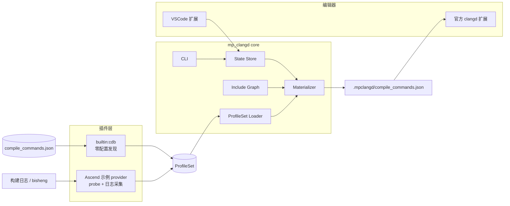

# mp_clangd

mp_clangd 在 clangd 之上提供 **profile（构建语境）** 和 **编译单元（unit）** 级的选择能力。它把同一份源码在不同 target、不同宏或不同编译器 pass 下的多份编译命令拆成可切换的 profile，并物化一份只包含当前选择项的 `compile_commands.json`，让官方 clangd 扩展直接使用。

mp_clangd 不 fork clangd，也不要求用户手写配置：默认情况下它会发现 workspace 内的 `compile_commands.json`，按目录生成 profile，并把同一文件的多条编译命令识别为 unit。Ascend C 的多 pass 编译以示例 provider 的形式提供，核心不包含任何 Ascend 分支。

## 项目定位

- **profile**：一套构建/链接语境，例如 `default`、`build/debug`、`default/AIC`、`default/AIV`。
- **unit**：同一 profile 内，同一个源文件的多条编译命令之一，例如同一个 kernel 的 cube 与 vector 两份编译命令。
- **通用核心**：ProfileSet 加载与校验、profile/unit 选择、物化 CDB、include 图、状态存储、CLI。
- **插件层**：`builtin:cdb` 零配置发现 CDB；Ascend 示例 provider 负责 probe 展开和构建日志采集。

## 架构



分层的唯一分界是 **ProfileSet**：provider 负责“profile 怎么产生”，核心只消费 ProfileSet；核心不认识 CDB、bisheng 或 Ascend。

## 目录结构

```text
mp_clangd/
├── packages/
│   ├── core/                # ProfileSet、物化、include 图、状态
│   ├── provider-cdb/        # 内置 cdb-provider
│   ├── cli/                 # mp-clangd 命令行
│   └── vscode-extension/    # VSCode 扩展
├── examples/
│   └── ascend-provider/     # Ascend 示例 provider、preset 与验收 fixture
└── docs/
    └── usage.md             # 配置 schema、preset 与 ProfileSet 用法
```

## 环境与安装

- Node.js 24（开发基线为 v24.18.0）。
- npm workspaces。
- 使用 VSCode 扩展时需要官方 clangd 扩展；Ascend 示例 provider 需要可执行的 `bisheng` 或 `ccec`。

```bash
npm install
npm run build
```

构建产物：

- `packages/cli/dist/main.js`：CLI。
- `packages/vscode-extension/dist/extension.js`：VSCode 扩展。
- `examples/ascend-provider/dist/main.js`：Ascend 示例 provider。

## 零配置快速开始

默认配置等价于只启用内置 `builtin:cdb` provider。它会发现 workspace 根目录及常见构建目录下的 `compile_commands.json`。

```bash
# 在 mp_clangd 仓库根目录构建后，可把 CLI 指向任意工程
MP_CLANGD=/path/to/mp_clangd/packages/cli/dist/main.js
cd /path/to/your/project

node "$MP_CLANGD" init       # 创建 .mpclangd/，并写入 .gitignore
node "$MP_CLANGD" refresh    # 运行 provider，生成 profiles.json 与物化 CDB
node "$MP_CLANGD" profiles   # 列出 profile
node "$MP_CLANGD" profile build/debug
```

在 mp_clangd 仓库根目录也可以直接使用 workspace 链接出来的命令：

```bash
npx mp-clangd profiles
```

默认发现规则：

- 根目录 `compile_commands.json`。
- `build*/**/compile_commands.json`、`out/**/compile_commands.json`、`cmake-build-*/**/compile_commands.json`。
- 最大深度 4；忽略 `.git`、`node_modules`、`.tmp`、`.mpclangd`。
- 每个 CDB 生成一个 profile，id 取相对目录（POSIX 分隔符）；根目录为 `default`；id 冲突时追加 `#2`、`#3`。

## CLI

| 命令 | 作用 |
|---|---|
| `mp-clangd init` | 创建 `.mpclangd/`，并把 `.mpclangd/` 写入 `.gitignore`。 |
| `mp-clangd providers` | 列出 `mp_clangd.yaml` 中配置的 provider。 |
| `mp-clangd profiles` | 运行 provider 并列出 profile 及 entry 数量。 |
| `mp-clangd profile [name]` | 不带参数时显示当前 profile；带参数时切换 profile、保存状态并重新物化。 |
| `mp-clangd unit <file> [name]` | 不带 `name` 时列出该文件的 unit；带 `name` 时按 label 或 key 选择并保存。 |
| `mp-clangd headers <header>` | 打印能到达该头文件的 include 链（`root -> ... -> header`）。 |
| `mp-clangd refresh` | 重新运行 provider，写入 `.mpclangd/profiles.json` 并物化当前 profile。 |
| `mp-clangd doctor` | 检查 `.mpclangd/profiles.json`、`.mpclangd/compile_commands.json`、`.vscode/settings.json` 中的 clangd 参数，并逐个报告 provider 状态。 |

示例：

```bash
npx mp-clangd profiles
# build/debug (42 entries)
# build/release (42 entries)

npx mp-clangd profile build/debug
# active profile: build/debug
# wrote 42 entries to /path/to/project/.mpclangd/compile_commands.json

npx mp-clangd unit src/kernel.cpp
# units for /path/to/project/src/kernel.cpp (profile build/debug):
#   a.o (<sha1>)
#   b.o (<sha1>)

npx mp-clangd unit src/kernel.cpp b.o
# unit for /path/to/project/src/kernel.cpp: b.o

npx mp-clangd doctor
# ok .mpclangd/profiles.json
# ok .mpclangd/compile_commands.json
# missing .vscode/settings.json contains --compile-commands-dir=.mpclangd
# provider builtin:cdb: ok
```

unit 的 label 规则：

1. 取该 entry 中其他 entry 没有的 `-D` 宏（去掉 `-D`）；
2. 否则取 `-o` 输出文件的 basename；
3. 否则使用 `unit <序号>`；
4. 同 label 冲突时追加 ` #2`、` #3`。

物化 CDB 中每个文件只保留一条 entry；其他文件仍使用各自保存的选择，未选择时使用按 label 排序后的第一条 unit。VSCode 扩展在切换 profile/unit 后立即重新物化；CLI 的 `profile` 会立即重新物化，CLI 的 `unit` 只保存选择，需要再执行 `refresh`（或选择一个 profile）后生效。

## VSCode 扩展

1. 构建扩展：

   ```bash
   npm run build --workspace mp-clangd-vscode
   ```

2. 安装并启用官方 clangd 扩展。
3. 以扩展开发模式启动 VSCode，例如：

   ```bash
   code --extensionDevelopmentPath=/path/to/mp_clangd/packages/vscode-extension /path/to/workspace
   ```

4. 打开一个 workspace 文件夹。扩展激活后会检查 `.vscode/settings.json` 的 `clangd.arguments`，缺少 `--compile-commands-dir=.mpclangd` 时提示写入。

功能：

- **状态栏**：左侧显示当前 profile，点击可切换；右侧只在当前文件有多个 unit 时显示 unit，点击可切换。
- **命令面板**：
  - `mp_clangd: Select Profile`
  - `mp_clangd: Select Compile Unit`
  - `mp_clangd: Refresh`
  - `mp_clangd: Doctor`
  - `mp_clangd: Show Header Paths`
  - `mp_clangd: Select Header Root`
- **Include Paths 视图**：位于资源管理器（Explorer），列出当前头文件的所有根 TU 及其 include 链。默认根的优先级为：
  1. 导航到该头文件时来源的源文件；
  2. 该头文件的历史选择；
  3. 按路径字母序第一条。
- 切换 profile/unit/头文件根后重新物化 CDB，并调用 `clangd.restart` 重新加载。
- 扩展优先读取 `.mpclangd/profiles.json`；文件存在且合法时直接使用，激活阶段不运行 provider，文件不存在时激活阶段也不运行 provider。`Select Compile Unit` 在内存缓存或合法的 `profiles.json` 可用时不会运行 provider，只有两者都不可用时才回退到运行 provider；`Refresh` 与 `Select Profile` 始终运行 provider，并重新生成 `.mpclangd/profiles.json`。

## ProfileSet 与 provider 契约

provider 输出统一的 JSON（标准输出，或 `output` 指定的文件）：

```json
{
  "profiles": [
    {
      "id": "build/debug",
      "entries": [
        {
          "directory": "/abs/build/debug",
          "file": "/abs/src/kernel.cpp",
          "arguments": ["clang++", "-std=c++17", "-c", "/abs/src/kernel.cpp", "-o", "kernel.o"]
        }
      ]
    }
  ]
}
```

约束：

- 顶层必须是对象，且 `profiles` 是数组。
- `profile.id` 非空且在同一 ProfileSet 内唯一；多个 provider 合并时也不得重复。
- `entry.directory` 必须是绝对路径。
- `entry.file` 非空；相对路径按 `directory` 解析为绝对路径。
- `entry.arguments` 是非空字符串数组，第一项为编译器/驱动。
- `entry.unverified`（可选，布尔）是诊断标记：provider 无法完成精确 probe 或宏校验、只能回退到启发式参数时为 `true`；核心在校验、合并与物化（含头文件 entry）时原样保留。
- 核心不检查文件是否真实存在；provider 负责生成 clangd 可用的 driver 风格命令（宏、include、关键字擦除）。
- 同一 profile 内同一 `file` 的多条不同 entry 即多个 unit；完全相同的命令会去重。

内置 `builtin:cdb`、`command` provider 以及手工生成 ProfileSet 的完整说明见 [docs/usage.md](docs/usage.md)。

## 可选配置 `mp_clangd.yaml`

`mp_clangd.yaml` 放在 workspace 根目录。省略时只启用 `builtin:cdb`。

```yaml
providers:
  - use: builtin:cdb
    include: ["build*/**/compile_commands.json"]
    exclude: [".git", "node_modules", ".tmp"]
  - use: command
    command:
      - node
      - /abs/path/to/mp_clangd/examples/ascend-provider/dist/main.js
      - --workspace
      - "{workspace}"
      - --preset
      - /abs/path/to/mp_clangd/examples/ascend-provider/preset.yaml
```

`providers` 是完整集合，按顺序执行并合并；profile id 冲突会报错。命令 provider 的工作目录是 workspace，命令 token 支持 `{workspace}` 与 `{config}` 替换。

## 文件布局

```text
.mpclangd/
├── profiles.json           # provider 输出或合并结果
├── compile_commands.json   # 当前 profile 的物化 CDB
├── state.json              # 当前 profile、每文件 unit、头文件选择与历史
└── cache/                  # provider 缓存（例如 probe/<hash>.json）
```

`.mpclangd/` 由 `mp-clangd init` 写入 `.gitignore`。

## M1 限制

- **不支持 `.asc` 文件的导航**。M1 的目标工程使用 `.cpp` 源文件加 `-xasc` 编译；`<<<>>>`、`[aicore]` 等语法的原生解析属于后续阶段。
- **不 fork clangd**。M1 使用官方 clangd 扩展与物化 CDB；不修改 clangd 二进制。
- **Ascend 适配是示例 provider**，位于 `examples/ascend-provider/`，不进入核心代码。
- **单 workspace**。不支持多根 workspace、远程开发或其他编辑器 UI。
- **静态 include 图**。include 链由源码静态扫描近似得到，不使用编译器依赖输出；条件编译可能造成过度近似。
- **头文件 entry 按需物化**。只对已打开或显式选择过根 TU 的头文件写入 entry；include 图在首次 `Show Header Paths` 或头文件激活时惰性构建，构建失败不会永久缓存、下次会重试。
- **provider 与 probe 同步执行**。M1 在扩展宿主中通过 `spawnSync` 同步运行 provider/probe（`maxBuffer` 64 MiB、超时 120 s）；大工程首次 `Refresh` 可能让扩展宿主短暂卡顿，异步执行留待后续阶段。Ascend provider 的 probe 结果缓存在 `.mpclangd/cache/probe/<hash>.json`，临时目录在每次 probe 后递归删除。
- **`doctor` 报告生成文件、clangd 参数与 provider 状态**。它逐个运行配置中的 provider 并报告成功或失败；单个 provider 失败不会中止其他检查。它不探测编译器版本或 probe 是否可用。
- **部分验收项尚未在当前环境验证**（stock clangd 解析物化 CDB、状态栏切换、头文件树 UI）。具体原因与操作员手工步骤见 [UNVERIFIED 清单](examples/ascend-provider/README.md#7-未验证项unverified)。

## 开发与测试

```bash
npm test          # Vitest 全量测试
npm run typecheck # tsc --noEmit
npm run build     # 构建全部 workspace 包
```

## 文档

- [docs/usage.md](docs/usage.md)：`mp_clangd.yaml` schema、Ascend preset、手工生成 ProfileSet。
- [examples/ascend-provider/README.md](examples/ascend-provider/README.md)：Ascend provider 的运行方式与 `cann_tmp` 验收记录。
- [docs/superpowers/specs/2026-11-20-mp-clangd-multiconfig-design.md](docs/superpowers/specs/2026-11-20-mp-clangd-multiconfig-design.md)：设计文档。
