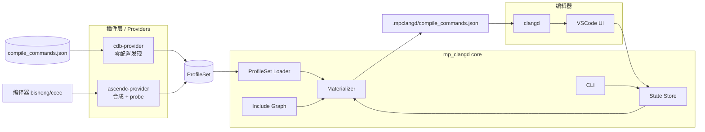

# mp_clangd 多配置 clangd 设计

## 1. 背景与出发点

### 1.1 通用痛点

clangd 对每个源文件只使用 `compile_commands.json` 中第一条匹配的 entry，没有“选择配置”的概念（[clangd #2004](https://github.com/clangd/clangd/discussions/2004)）。真实 C++ 工程中同一份源码常常在不同 target、不同宏下被编译成多份产物：

| 场景 | 同一文件的多份产物 |
|---|---|
| Linux x86 vDSO | `vclock_gettime.c` 同时编成 32 位与 64 位 vDSO 对象（`vclock_gettime-32.o` 等） |
| PostgreSQL | `src/common`、`src/port` 的源码同时编成 backend 与 frontend（`-DFRONTEND`）两份 |
| 嵌入式多核 | 同一个 `.c` 按 `-DCPU_ID=0/1/...` 为每个核编一份 |
| glibc | 同一源码按 ABI（x86_64 / x32）编多份，构建目录分开 |
| CMake / Bazel 多 target | 同一源文件进入多个 target，宏与 include 不同 |
| Linux kernel 配置 | 同一头文件被不同 `CONFIG_*` 组合的 TU 引用 |

头文件的问题同样通用：一个 `.h` 会被不同 TU 以不同宏展开；clangd 打开头文件时只能挑一套 flags，导致 `#ifdef` 分支里的符号无法跳转或跳到错误定义。

### 1.2 现有方案与不足

- 每个 target 生成一份 `compile_commands.json`，手动切换并重启 clangd（[clangd #1504](https://github.com/clangd/clangd/discussions/1504) 的推荐做法）：能用，但没有统一的 profile/unit 模型，切换成本高。
- 按目录放多份 CDB：clangd 按最近祖先查找，无法表达“同一路径、不同配置”。
- 第三方工具（如 Pigweed 的 `pw_ide`）用 per-toolchain CDB 加稳定符号链接来切换：思路接近，但只覆盖它自己的构建体系。
- 合并 flags：会产生假错误，clangd 明确拒绝。
- 嵌入式多核的 `-DCPU_ID` 场景已有同类报告（[clangd #1834](https://github.com/clangd/clangd/issues/1834)）：clangd 只用第一条命令，切换需要重排 CDB。

### 1.3 与 Ascend 的关系

Ascend C 只是这个通用问题的一个极端案例：`bisheng -xasc --npu-arch=...` 一次编译内部展开 Host/Cube/Vector 三个 pass，最终只产出一个嵌入了 `.aicore_binary` 的 `.o`，CDB 里只有一条 entry。

mp_clangd 的核心不针对 Ascend：核心只定义 profile/unit 选择、物化和 clangd 接入；Ascend 的 TU 拆分、pass 展开、opc/TBE entry 合成全部放在插件层。先做 Ascend 只是因为它的拆分逻辑最复杂，能验证插件契约是否足够通用。

mp_clangd 的目标：在 clangd 之上提供 profile 级和编译单元级的配置选择，并交付 CLI 与 VSCode 扩展；Ascend 工程只作为验收 fixture。

## 2. 目标、非目标与反目标

### 2.1 目标

- 通用：适用于任何同一文件被多次编译的 C++ 工程；零配置发现 workspace 内的 CDB，自动生成 profile；同一 CDB 内同一文件的多条 entry 自动识别为编译单元。
- 支持每个文件独立选择编译单元；头文件视角由“根 TU”决定，展示其所有 include 路径，并按规则记忆选择。
- 通过物化 CDB + 官方 clangd 扩展工作（A 方案），不要求用户替换 clangd。
- 对多 pass 编译器提供 compiler-probe 展开，得到准确的 per-`.o` 宏环境；Ascend `-xasc` 是首个用例。
- 交付客户面：可选 `mp_clangd.yaml`、`mp-clangd` CLI、VSCode 状态栏与树视图、ProfileSet/provider 契约、文档。
- Ascend 适配以 preset/example 形式存在，不进入核心代码。

### 2.2 非目标（M1）

- 不 fork clangd；`<<<>>>`、`[aicore]`、`-x asc` 的原生解析放在 B 阶段。
- 不承诺 `.asc` 文件的导航；M1 目标工程使用 `.cpp` + `-xasc`。
- 不做编译器级精确 include 依赖，使用静态扫描加缓存。
- 不做多根 workspace、远程开发、其他编辑器 UI。
- 不把修改 Ascend 工程作为交付内容。

### 2.3 反目标

- 用户必须手写配置才能使用。
- 把 Ascend 特定逻辑硬编码进核心。
- 通过合并宏（如 `-Dexe1 -Dexe2`）来“支持多配置”。
- 为不同配置生成影子源文件树。

## 3. 已确认的事实与约束

| 事实 | 结论 |
|---|---|
| clangd 对同一文件的多条 CDB entry 只取第一条 | 选择必须由外部物化或定制 clangd 实现 |
| clangd 12+ 会热重载 CDB（mtime+size，约 1 秒节流） | 改写物化 CDB 后不必总是重启 clangd |
| `ccec -xasc ... -c` 最终只产出一个 `.o`，内部存在 cube/vec 临时 `.o` | 需要 probe 才能拿到 per-`.o` 编译命令 |
| `-v -c` 会打印 `-cc1` 子进程命令行 | 这是 compiler probe 的实现基础 |
| `-fsyntax-only` 与 `-E` 不区分 cube/vec | probe 必须使用 `-c` |
| `__DAV_CUBE__`/`__DAV_VEC__` 由前端按 arch 注入 | stock clang 需要手工补宏 |
| `__aicore__` 宏展开为 `[aicore]`；`__gm__` 等是编译器关键字 | A 阶段用 `-D` 擦除 |
| Ascend 构建有两类：CMake + bisheng 会产出 CDB；opc/TBE 不产出 | 前者可零配置，后者需要合成 entry |
| opc/TBE 的 kernel 编译最终也调用 bisheng（`-x cce`） | 编译器相同，区别只是命令不在 CDB 里 |

## 4. 术语

- **workspace**：项目根目录。
- **profile**：一套构建/链接语境的配置，对应一组 entry；AIC/AIV 就是两个 profile。
- **entry**：一条编译命令。
- **compile unit（unit）**：同一 profile 内，同一文件的多条 entry 之一。
- **root TU**：决定头文件编译视角的根编译单元。
- **materialized CDB**：核心生成给 clangd 的 `.mpclangd/compile_commands.json`。
- **provider（插件层）**：生成 profile 的组件；内置 `cdb-provider`，Ascend 以示例 provider 提供。
- **ProfileSet**：provider 与核心之间的唯一契约，包含 profiles 与 entries。
- **preset**：provider 的匹配规则与宏表，Ascend 适配以 preset 形式提供。
- **probe**：调用编译器 `-v -c` 并解析 per-pass 命令行。

## 5. 总体架构

分层的唯一分界是 **ProfileSet**：生成 profile 之前的一切属于插件层，之后的一切属于核心。



- **插件层**：`cdb-provider` 负责零配置 CDB 发现与 unit 识别；`ascendc-provider` 负责 opc/TBE entry 合成、compiler probe，并直接输出 AIC/AIV 两个 profile。
- **核心**：只消费 ProfileSet，负责 profile/unit 选择、物化、include 图、状态、clangd 生命周期、CLI 与 UI。
- 核心不认识 CDB、不认识 bisheng，也不含 Ascend 分支。
- 核心用 TypeScript 实现，CLI 与 VSCode 扩展共用；M1 的编辑器侧仍使用官方 clangd 扩展。

## 6. 客户面契约

### 6.1 分层边界

- **插件层（provider）**：负责“profile 怎么产生”——CDB 发现、entry 合成、probe 展开、生成 profile。
- **核心（mp_clangd）**：只消费 ProfileSet，负责 profile/unit 选择、物化、include 图、状态、clangd 生命周期、CLI/UI。
- 内置 `cdb-provider` 提供零配置发现；Ascend provider 作为示例放在 `examples/`。

### 6.2 ProfileSet 契约

provider 输出统一的 JSON（默认 `.mpclangd/profiles.json`；启用多个 provider 时各自输出片段，由核心合并）：

```json
{
  "profiles": [
    {
      "id": "ascend910b-debug/AIC",
      "entries": [
        {
          "directory": "/abs/build",
          "file": "/abs/src/kernel.cpp",
          "arguments": ["bisheng", "-x", "c++", "-std=c++17", "..."],
          "unverified": true
        }
      ]
    }
  ]
}
```

- 同一 profile 内同一 `file` 的多条 entry 即编译单元；不需要额外的标签字段。
- 核心只接受绝对路径；相对路径按 `directory` 解析。
- provider 负责把命令转换成 clangd 可用的 driver 风格（含宏、include、关键字擦除）。
- `unverified`（可选，布尔）是诊断标记：provider 无法完成精确 probe 或宏校验、只能回退到启发式参数时置为 `true`。核心在校验、合并与物化（含头文件 entry）时原样保留该字段，供 UI 与用户判断配置是否可信。
- 核心校验路径与 profile id；不合法时进入只读错误状态并提示。
- 多个 provider 的输出由核心合并；profile id 冲突时报错。
- 初始 profile：优先使用上次选择（state），否则列表第一个。

### 6.3 零配置行为（内置 cdb-provider）

- 自动发现 `compile_commands.json`：workspace 根目录，以及 `build*/**`、`out/**`、`cmake-build-*`，默认最大深度 4，忽略 `.git`、`node_modules`、`.tmp`、`.mpclangd`。
- 每个 CDB 生成一个 profile，名字取相对目录；根目录的 profile 名为 `default`。
- 同一 CDB 内按文件分组：完全相同的命令去重；不同命令成为 unit，标签取差异 token（如 `dav-c220-cube`、`dav-c220-vec`，或 `-o` 的 basename）。
- 无法推导的 entry（CDB 中不存在，例如 opc/TBE 编译的 kernel）由 Ascend provider 合成，内置 provider 不处理。

### 6.4 可选配置 `mp_clangd.yaml`

```yaml
providers:
  - use: builtin:cdb
    include: ["build*/**/compile_commands.json"]
    exclude: [".git", "node_modules", ".tmp"]
  - use: command
    command: ["node", "examples/ascend/provider.js", "--workspace", "{workspace}"]
    config: examples/ascend/preset.yaml
    output: .mpclangd/profiles.json
```

`providers` 列表是完整集合；省略时默认使用 `builtin:cdb`。Ascend 项目通常只启用命令 provider，由它在内部复用 CDB 发现。配置文件只做覆盖与 provider 选择，不是使用的必要条件。

### 6.5 Ascend provider preset（示例，不进入核心）

```yaml
name: ascend
match:
  compilers: ["*bisheng*", "*ccec*"]
  args_any: ["-xasc", "-x asc", "-x cce"]
probe:
  parse: cc1
  passes:
    - name: AIC
      arch_suffix: "-cube"
      macros: [__NPU_DEVICE__, __DAV_CUBE__, __DAV_C220_CUBE__]
    - name: AIV
      arch_suffix: "-vec"
      macros: [__NPU_DEVICE__, __DAV_VEC__, __DAV_C220_VEC__]
sanitize:
  remove_args: ["-xasc", "-x asc", "-xcce", "-x cce", "--npu-arch=*", "--cce-*"]
  add_args: ["-x", "c++"]
  keyword_defines: [__gm__, __global__, __vector__, __cube__, __aicore__]
```

preset 是数据，不是代码；Ascend provider 为每个 pass 直接生成一个 profile（`<base>/AIC`、`<base>/AIV`），核心只消费它输出的 ProfileSet。

### 6.6 CLI

```
mp-clangd providers
mp-clangd profiles
mp-clangd profile [name]
mp-clangd unit [file] [name]
mp-clangd headers <header>
mp-clangd refresh
mp-clangd doctor
mp-clangd init
```

### 6.7 VSCode 扩展

- 状态栏左侧显示 profile，右侧显示当前文件的编译单元；只有多个 unit 时才显示右侧项。
- Include Paths 树视图：显示头文件的所有根 TU 与 include 链。
- 头文件默认选择优先级：① 导航到该头文件时来源的 c/cpp；② 该头文件的历史选择；③ 按路径字母序第一条。
- 切换时显示加载态，并触发 clangd 重载或重启。
- 首次激活时提示将 `--compile-commands-dir=.mpclangd` 写入 workspace 的 `clangd.arguments`。

### 6.8 状态与文件布局

```
.mpclangd/
├── profiles.json           # ProfileSet（provider 输出或合并结果）
├── compile_commands.json   # 物化结果
├── state.json              # 当前 profile、每文件 unit、头文件选择与历史
└── cache/                  # provider 缓存与 include 图缓存
```

`.mpclangd/` 由 `mp-clangd init` 写入 `.gitignore`。

## 7. 关键机制

### 7.1 内置 cdb-provider

1. 按配置收集 CDB 路径（根目录与常见构建目录）。
2. 读取每个 CDB，按 `directory` + `file` 归一化为绝对路径。
3. 同一 CDB 内按文件分组；命令规范化后去重。
4. 剩余多条命令按差异 token 生成 unit 标签（`-D` 差异、`-o` basename、特殊参数）。
5. 生成 ProfileSet；profile id 取相对目录，根目录为 `default`。

### 7.2 Ascend 示例 provider

Ascend provider 负责两类 CDB 中拿不到的输入：

1. **entry 合成**：opc/TBE 内核不进 CMake CDB。provider 从 op 配置或带 `-v` 的构建日志重建 bisheng driver 命令（`-x cce` / `-xasc`、include、宏、arch），作为 base entry。
2. **compiler probe 展开**：对匹配 preset 的 entry 执行：
   - 在 entry 的 `directory` 下运行原命令加 `-v -c`，输出到 `.mpclangd/cache/probe/run-<uuid>/` 下的临时目录；该目录（含 cube/vec 等设备 `.o`）在 `finally` 中递归删除，不保留对象文件；
   - 解析 stderr 中 ` -cc1 ` 行，按 `-o ...-cube.o` / `-vec.o` 识别 pass；
   - 对每个 pass 的 cc1 命令去掉 `-o` 后追加 `-dM -E`，检查 preset 为该 pass 声明的每个宏都已定义，并把校验结果随 pass 一起缓存；
   - 用原 driver 命令 + `sanitize` + preset 宏 + 关键字擦除宏，生成两条 clangd 可用的 entry；
   - 为每个 pass 直接生成一个 profile（`<base>/AIC`、`<base>/AIV`）。
3. 缓存：结果写入 `<workspace>/.mpclangd/cache/probe/<hash>.json`，值为 pass 名称与宏校验结果，不含对象文件。缓存键为 sha1(编译器路径 + 编译器 mtime + entry.directory + entry.arguments + 源文件 mtime)；命中时不再启动编译器。
4. probe 或宏校验失败时按 entry 回退：用原 driver 命令 + preset 的 pass 名称走 `buildClangdArgs` 生成回退 entry，置 `unverified: true`，向 stderr 输出一行警告并继续处理其他 entry 与 profile，不中止整个 provider 运行。

代价控制：

- **精确 probe**：每个文件一次真实编译，首次选中时执行并按缓存复用。
- **特征化 probe（默认推荐）**：每个（编译器版本, arch）用一个最小 kernel 做一次 probe，得到宏集合与模板，之后所有 entry 按模板展开。
- **构建日志采集**：如果构建本身可以加 `-v`，直接从日志解析，零额外编译。

### 7.3 核心：ProfileSet 加载与校验

1. 读取 `.mpclangd/profiles.json`，校验 profile id 唯一性与 entry 路径为绝对路径。
2. 按 profile 建立 `file -> entries` 索引，识别同一文件的多个 unit。
3. 初始 profile：上次选择的 profile，否则列表第一个。
4. 不合法时进入只读错误状态，CLI/UI 给出明确提示。

### 7.4 物化与 clangd 接入

- 物化 CDB 中每个文件只保留一条 entry：当前选中的 unit，或默认 unit。
- 头文件 entry：把所选根 TU 的命令复制给头文件路径，使 clangd 打开头文件时使用该配置。
- 原子写文件；写入后触发 clangd 重载（等待 mtime 变化），必要时调用 `clangd.restart`。
- 切换 profile 时按该 profile 的默认 unit 重建整份物化 CDB。

### 7.5 Include 图与头文件视角

- 静态扫描每个 entry 源文件的 `#include`，按该 entry 的 `-I`、`-isystem`、`-iquote` 和源文件目录解析。
- 建立反向边：header → includers；对头文件做反向遍历，得到所有根 TU 与 include 链。
- 头文件状态按 `(profile, header)` 记录所选根 TU 的完整标识 `(rootFile, unitLabel)`；根文件的 unit 变化时，所有以它为根的 header entry 需要重新物化。
- 头文件 entry 按需物化：只对已打开或显式选择过的头文件写入，避免物化 CDB 膨胀和索引副作用。
- 已知限制：条件编译下的 include 会被过度近似；生成文件缺失时跳过并记录。

### 7.6 与 clangd 的集成

- M1 使用官方 clangd 扩展，通过 workspace 设置注入 `--compile-commands-dir=.mpclangd`。
- 切换 unit 时只重写受影响文件的 entry；切换 profile 时重建整份 CDB。
- B 阶段替换为定制 clangd 二进制，通过 `clangd.path` 指向；上层 UI 与状态模型不变。

## 8. M1 范围与验收

### 8.1 验收 fixture 与环境基线

- 本地仓库 `/root/repo/cann/ops-transformer`（以当前 checkout 为准，不使用上游最新布局）。
- `examples/fast_kernel_launch_example/csrc/add`：已有 CDB、存在 `-xasc` 与 `<<<>>>`。M1 用于验证 probe 能解析出 cube/vec 两条 per-`.o` 命令；`<<<>>>` 的解析留给 B。
- `examples/add_example`：kernel 由 opc/TBE 编译，CDB 中没有 entry。用于验证 Ascend 示例 provider 的 entry 合成路径，以及无 `<<<>>>` 文件在 stock clangd 下的导航。
- 环境：`cann_tmp` 容器，CANN 9.2.0，`ccec`/`bisheng` 基于 clang 15.0.5；容器内暂无 clangd，M1 开发时安装最新稳定版（≥18）作为基线。

### 8.2 验收标准

- `mp-clangd profiles` 能在无配置下列出 cdb-provider 生成的 profile 与 unit。
- Ascend provider 能对 `-xasc` entry 输出 `<base>/AIC`、`<base>/AIV` 两个 profile；preset 声明的宏与编译器 `-dM` 结果一致（只校验声明的宏，不要求完整宏集合）。
- `add_example` 路径下，Ascend provider 能合成 kernel entry 并输出 ProfileSet。
- 核心能加载 ProfileSet 并物化为 `.mpclangd/compile_commands.json`；stock clangd 能对无 `<<<>>>` 的 kernel 文件解析头文件与符号。
- 状态栏可切换 profile/unit，切换后 clangd 重新加载生效。
- 头文件树视图能列出所有根 TU 与 include 链，默认选择符合优先级规则并跨会话记忆。
- `mp-clangd doctor` 能报告 clangd 参数、ProfileSet、物化 CDB、provider 状态。

### 8.3 交付物

- `mp-clangd` CLI 与核心库。
- VSCode 扩展。
- ProfileSet 契约与内置 `cdb-provider`。
- Ascend 示例 provider、preset 与两个 fixture 的使用说明。
- 客户面文档：零配置行为、`mp_clangd.yaml` schema、ProfileSet/provider 契约、CLI 与 UI 用法。

## 9. B 阶段（后续）

- 维护 LLVM fork，最小补丁面：`<<<>>>`、`[aicore]`、把 `-x asc` 当作带扩展的 C++。
- 定制 clangd 原生消费 `-xasc` 命令，内部完成 cube/vec 的视图切换，不再需要物化时改写宏。
- 可选的原生 per-file 选择与索引重建。

## 10. 风险与未决项

| 风险 | 应对 |
|---|---|
| probe 需要真实编译，大工程首轮可能较慢 | 特征化 probe + 懒加载 + 缓存；支持从构建日志采集 |
| 编译器版本差异导致宏集合变化 | 缓存键包含编译器版本与 mtime；preset 可按版本覆盖 |
| clangd 热重载是懒触发，切换后诊断不立即刷新 | 显示加载态；必要时调用 `clangd.restart` |
| 静态 include 图在条件编译下不精确 | M1 接受过度近似；后续可改用编译器依赖输出 |
| 头文件作为 entry 可能被 clangd 当作 TU 索引 | 接受；观察索引重复情况，必要时在物化层规避 |
| 多根 workspace 未支持 | M1 文档声明限制 |

## 11. 备选方案与取舍

| 方案 | 结论 |
|---|---|
| A. 外部物化 CDB | 选为 M1：零 fork、与官方 clangd 兼容 |
| B. 定制 clangd | 后续：解决 `<<<>>>` 与 `[aicore]`，并消除物化改写 |
| AIC/AIV 作为两个 profile | M1 采用：与链接产物语义一致，UI 简单 |
| 同一文件多条 entry 作为 unit | 保留：通用多 target 场景 |
| profiles 之前归插件层 | 采用：provider 输出 ProfileSet，核心只消费 |
| 必须有配置文件 | 否决：默认零配置推导，配置只做覆盖 |
| probe 与启发式 | probe 为默认，启发式为失败兜底 |
| 物化 CDB 放 `.mpclangd/` | 采用；避免覆盖项目根 CDB |

## 12. 构建者需要决定的细节

- cdb-provider 的 unit 标签与去重规则。
- Ascend provider 的 probe 模式（特征化 vs 逐文件精确）与缓存失效策略。
- 物化 CDB 的写入节流与 clangd 重载触发方式。
- include 图扫描的并发与增量更新策略。
- 状态文件的具体 schema 与迁移策略。
- VSCode 状态栏与树视图的交互细节。
